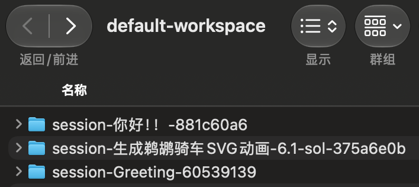
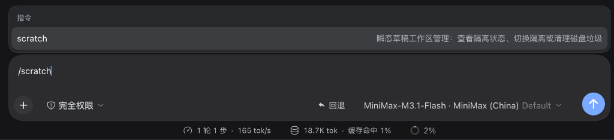
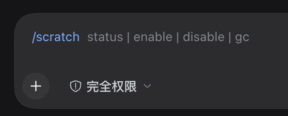
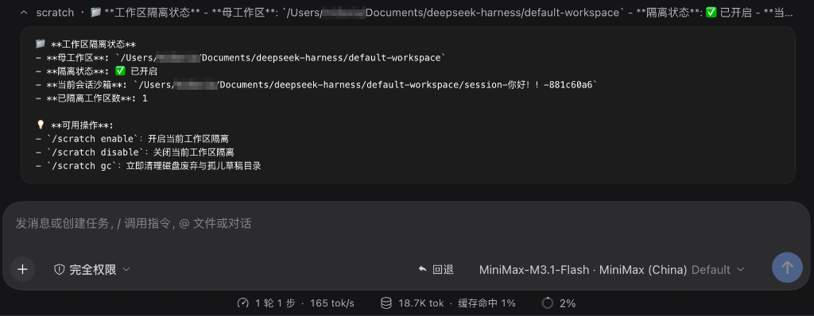
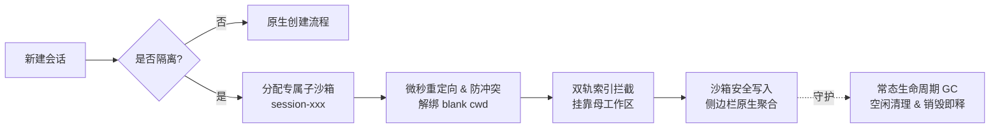

<h1 align="center">📦 dsh-scratch-workspace</h1>

<p align="center">
  DeepSeek Harness (DSH) 会话级沙箱隔离与草稿常态洁净插件
</p>

<p align="center">
  
  
  
  <a href="LICENSE"></a>
</p>

<p align="center">
  <strong>简体中文</strong> · <a href="README_EN.md">English</a>
</p>

> [!IMPORTANT]
> **本插件顺应 DSH 原生架构规范，以永久兼容设计解决即兴会话文件踩踏、侧边栏混乱与磁盘残留痛点。**
>
> 既保持会话与项目在侧边栏的优雅归集，又为每个即兴会话提供独立的写入沙箱与自动垃圾回收（GC），杜绝版本断层风险。

---

## 插件用途

在 DeepSeek Harness 日常开发中，同时运行多个会话或使用默认工作区即兴提问时，开发者普遍面临以下三大核心痛点：

1. **文件相互踩踏**：原生机制下所有会话共享同一个工作区目录，并行运行的 Agent 会互相覆盖对方产出的代码或临时脚本。
2. **版本断层红屏**：传统补丁方案（如 `dsh-session-isolation`）强依赖旧版内部私有函数 `sessionPath`，在 DSH 升级到 `0.2.x` 后直接抛错崩溃。
3. **磁盘垃圾持续蔓延**：即兴会话产生的废弃文件与临时产物长期滞留，缺乏生命周期回收机制。

### 方案对比

| 评估维度 | 原生 DSH 默认机制 | 传统猴子补丁 (`dsh-session-isolation`) | dsh-scratch-workspace (本插件) |
| :--- | :--- | :--- | :--- |
| **会话写隔离** | 共享工作区根目录，易互相踩踏 | 独立 `session-<id>` 子沙箱 | **独立 `session-<id>` 子沙箱，项目只读安全** |
| **DSH 版本兼容** | 官方原生 | 强依赖 `sessionPath`，0.2.x 升级即红屏 | **永久兼容：自适应 `candidateMatches` 与 `sessionPath`，防认领冲突** |
| **侧边栏整洁** | 堆叠在单一工作区 | 易因校验失效退化为 Ungrouped 孤儿项 | **常态整洁：会话严格归集于母工作区树下** |
| **磁盘生命周期** | 无清理机制，废弃文件永久堆积 | 无有效 GC，废弃目录长期滞留 | **双重 GC：销毁即时释放 + 孤儿与空闲自动回收** |
| **即兴提问体验** | 污染 `default-workspace` | 需手动放置 `.dsh-isolate` 标记 | **默认工作区自动隔离，即用即走** |

---

## 效果一览

- 🚀 **并行开发零干扰**：多个会话同时对同一项目执行重构、分析或测试，产物互不交叉。
- 🛡️ **无感平滑升级**：不受 DSH 小版本架构调整影响，插件长久稳定运行。
- 📂 **侧边栏清爽如初**：所有会话紧密附着于所属工作区，消除孤儿会话打扰。
- 🧹 **磁盘常态零负担**：废弃临时目录自动清理，保持本地环境轻盈纯净。

| 侧边栏原生聚合 (DSH 界面) | 物理沙箱隔离 (Finder 真实目录) |
| :---: | :---: |
|  |  |
| **顶层统一归集**：会话在侧边栏完整归属母工作区，拒绝臃肿碎片化，保持工作区清爽 | **底层物理隔离**：每个会话分配专属 `session-<标题>-<ID>` 子目录，改名实时就地同步，产物互不踩踏 |

| 交互式斜杠指令 (Slash Command) | ⭐ 即时状态看板与向导 (/scratch) |
| :---: | :---: |
| <br/><br/> |  |
| **开箱即用的指令交互**：输入 `/scratch` 自动补全，支持 `status`、`enable`、`disable` 与 `gc` | **状态一目了然（核心看板）**：清晰展示母工作区映射、会话沙箱物理路径与快捷运维向导 |

---

## 架构与技术原理



### 核心方法与实现机制

1. **物理级写沙箱与项目只读保护**：
   在隔离工作区中为新会话动态创建 `session-<shortId>` 子目录，并重定向会话的写入边界。所有文件写入均收敛于该子目录，项目既有代码和文件对会话只读可用。
2. **双轨版本自适应（永久兼容）**：
   - 适配 DSH `0.2.x+`：包裹 `candidateMatches(id, path)`，将沙箱路径映射至母工作区。
   - 兼容 DSH `0.1.x`：保留对 `sessionPath(id)` 与 `rememberSessionPath(id, path)` 的安全适配。
   - 彻底防范 `ApiSessionCwdConflict`：当客户端复用带有历史根路径的空白会话时，自动解除路径认领绑定，平滑分配新会话标识。
3. **磁盘常态化垃圾回收引擎 (Lifecycle GC)**：
   - **实时释放**：监听会话删除事件，实时删除对应的沙箱目录。
   - **空闲回收**：对创建后超过 5 分钟且无实际文件产出的空沙箱进行静默清理。
   - **TTL 孤儿扫描**：后台每 30 分钟轮巡检测已无活动会话对应且超过 24 小时的孤儿目录。

---

## 安装与使用

### 方式一：从 npm 安装（推荐）

```bash
dsh plugin add dsh-scratch-workspace
# 或者通过 npm / pnpm
pnpm add dsh-scratch-workspace
```

### 方式二：从本地安装（开发调试）

在 DeepSeek Harness 所在配置 Profile 中添加本插件依赖（例如 `~/.dsh/profiles/desktop`）：

```bash
# 1. 链接到你的 DSH Profile
cd ~/.dsh/profiles/desktop
pnpm add "link:/path/to/dsh-scratch-workspace"

# 2. 将 "dsh-scratch-workspace" 添加到 package.json 中的 dsh.profile.bundles 列表

# 3. 重启 DeepSeek Harness
```

### 方式二：通过 Git URL 安装

```bash
dsh plugin --profile desktop add https://github.com/MDX-Tom/dsh-scratch-workspace.git
```

---

## 开启与控制隔离

插件支持多种灵活的开启与控制方式：

1. **对话内 Slash 命令（推荐）**：
   在聊天输入框键入 `/scratch` 或 `/isolate` 即可调出交互命令，支持：
   - `/scratch status`：查看当前工作区隔离状态与草稿目录信息
   - `/scratch enable`：为当前工作区开启沙箱隔离（自动写入 `.dsh-isolate` 标记）
   - `/scratch disable`：关闭隔离
   - `/scratch gc`：立即执行磁盘垃圾清理，回收空闲与孤儿会话目录
2. **目录标记文件 (`.dsh-isolate`) 与免配置自启**：
   - **自定义工程/普通工作区**：在根目录下放置 `.dsh-isolate` 标记文件作为持久化依据，设置随目录与代码仓库移动。
   - **默认工作区 (`default-workspace`)**：内置免配置自启，开箱即用，无需手动放置或生成标记文件。
3. **Agent 智能调用 (LLM Tool)**：
   模型可自动调用 `session_isolation` 工具查看或切换隔离状态：
   - `action: "enable"`：为当前工作区开启隔离
   - `action: "disable"`：关闭隔离
   - `action: "status"`：查看当前目录隔离状态
   - `action: "gc"`：立即执行磁盘垃圾清理
4. **插件详情与配置说明**：
   在 DSH 侧边栏点击 **「插件」** → 选择 **dsh-scratch-workspace** 即可查看插件行为与自动清理机制摘要。

---

## 运行自动化测试

本插件内置轻量单元测试，完全基于 Node.js 原生 test runner：

```bash
cd "dsh-scratch-workspace"
node --test "tests/*.test.js"
```

---

## License

[MIT](LICENSE)
