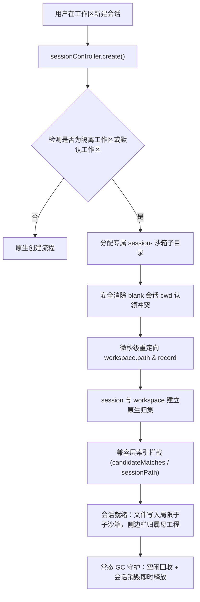

<h1 align="center">📦 dsh-scratch-workspace</h1>

<p align="center">
  DeepSeek Harness (DSH) 会话级沙箱隔离与草稿常态洁净插件
</p>

<p align="center">
  
  
  
  <a href="LICENSE"></a>
</p>

<p align="center">
  <strong>简体中文</strong> · <a href="README_EN.md">English</a>
</p>

> [!IMPORTANT]
> **本插件顺应 DSH 原生架构规范，以永久兼容设计解决即兴会话文件踩踏、侧边栏混乱与磁盘残留痛点。**
>
> 既保持会话与项目在侧边栏的优雅归集，又为每个即兴会话提供独立的写入沙箱与自动垃圾回收（GC），杜绝版本断层风险。

---

## 为什么需要它（面向什么问题）

在 DeepSeek Harness 日常开发中，同时运行多个会话或使用默认工作区即兴提问时，开发者普遍面临以下三大核心痛点：

1. **文件相互踩踏**：原生机制下所有会话共享同一个工作区目录，并行运行的 Agent 会互相覆盖对方产出的代码或临时脚本。
2. **版本断层红屏**：传统补丁方案（如 `dsh-session-isolation`）强依赖旧版内部私有函数 `sessionPath`，在 DSH 升级到 `0.2.x` 后直接抛错崩溃。
3. **磁盘垃圾持续蔓延**：即兴会话产生的废弃文件与临时产物长期滞留，缺乏生命周期回收机制。

### 方案对比

| 评估维度 | 原生 DSH 默认机制 | 传统猴子补丁 (`dsh-session-isolation`) | dsh-scratch-workspace (本插件) |
| :--- | :--- | :--- | :--- |
| **会话写隔离** | 共享工作区根目录，易互相踩踏 | 独立 `session-<id>` 子沙箱 | **独立 `session-<id>` 子沙箱，项目只读安全** |
| **DSH 版本兼容** | 官方原生 | 强依赖 `sessionPath`，0.2.x 升级即红屏 | **永久兼容：自适应 `candidateMatches` 与 `sessionPath`，防认领冲突** |
| **侧边栏整洁** | 堆叠在单一工作区 | 易因校验失效退化为 Ungrouped 孤儿项 | **常态整洁：会话严格归集于母工作区树下** |
| **磁盘生命周期** | 无清理机制，废弃文件永久堆积 | 无有效 GC，废弃目录长期滞留 | **双重 GC：销毁即时释放 + 孤儿与空闲自动回收** |
| **即兴提问体验** | 污染 `default-workspace` | 需手动放置 `.dsh-isolate` 标记 | **默认工作区自动隔离，即用即走** |

---

## 用什么方法（架构与技术原理）



### 核心方法与实现机制

1. **物理级写沙箱与项目只读保护**：
   在隔离工作区中为新会话动态创建 `session-<shortId>` 子目录，并重定向会话的写入边界。所有文件写入均收敛于该子目录，项目既有代码和文件对会话只读可用。
2. **双轨版本自适应（永久兼容）**：
   - 适配 DSH `0.2.x+`：包裹 `candidateMatches(id, path)`，将沙箱路径映射至母工作区。
   - 兼容 DSH `0.1.x`：保留对 `sessionPath(id)` 与 `rememberSessionPath(id, path)` 的安全适配。
   - 彻底防范 `ApiSessionCwdConflict`：当客户端复用带有历史根路径的空白会话时，自动解除路径认领绑定，平滑分配新会话标识。
3. **磁盘常态化垃圾回收引擎 (Lifecycle GC)**：
   - **实时释放**：监听会话删除事件，实时删除对应的沙箱目录。
   - **空闲回收**：对创建后超过 5 分钟且无实际文件产出的空沙箱进行静默清理。
   - **TTL 孤儿扫描**：后台每 30 分钟轮巡检测已无活动会话对应且超过 24 小时的孤儿目录。

---

## 达到了什么效果

- 🚀 **并行开发零干扰**：多个会话同时对同一项目执行重构、分析或测试，产物互不交叉。
- 🛡️ **无感平滑升级**：不受 DSH 小版本架构调整影响，插件长久稳定运行。
- 📂 **侧边栏清爽如初**：所有会话紧密附着于所属工作区，消除孤儿会话打扰。
- 🧹 **磁盘常态零负担**：废弃临时目录自动清理，保持本地环境轻盈纯净。

---

## 安装与使用

### 方式一：从本地安装（开发调试）

在 DeepSeek Harness 所在配置 Profile 中添加本插件依赖（例如 `~/.dsh/profiles/desktop`）：

```bash
# 1. 链接到你的 DSH Profile
cd ~/.dsh/profiles/desktop
pnpm add "link:/Users/midaxia/Documents/Projects/Codex Projects/dsh-plugins/dsh-scratch-workspace"

# 2. 将 "dsh-scratch-workspace" 添加到 package.json 中的 dsh.profile.bundles 列表

# 3. 重启 DeepSeek Harness
```

### 方式二：通过 Git URL 安装

```bash
dsh plugin --profile desktop add https://github.com/MDX-Tom/dsh-scratch-workspace.git
```

---

## 开启与控制隔离

隔离状态以工作区目录内的 `.dsh-isolate` 标记文件作为持久化依据，设置随目录移动，也可在以下入口灵活控制：

1. **Web GUI 设置面板**：
   进入 **设置 → 插件 → 工作区隔离与清理**，可一览所有工作区的隔离状态，一键开关，或点击 **“立即清理磁盘孤儿目录”** 执行 GC。
2. **对话内指令 / Tool**：
   直接对 Agent 提问调用 `session_isolation` 工具：
   - `action: "enable"`：为当前工作区开启隔离
   - `action: "disable"`：关闭隔离
   - `action: "status"`：查看当前目录隔离状态
   - `action: "gc"`：立即执行磁盘垃圾清理
3. **默认工作区自动开启**：
   无需任何操作，默认工作区 (`default-workspace`) 自动享受沙箱隔离与草稿清理效果。

---

## 运行自动化测试

本插件内置轻量单元测试，完全基于 Node.js 原生 test runner：

```bash
cd "dsh-scratch-workspace"
node --test "tests/*.test.js"
```

---

## 发布路线说明

本插件支持多种发布路线：

### 路线 A：GitHub 开源仓库发布（推荐，适合社区分享）
1. 在 GitHub 上创建对应仓库 `dsh-scratch-workspace`。
2. 将本地代码 push 到远端：
   ```bash
   git remote add origin https://github.com/<your-username>/dsh-scratch-workspace.git
   git push -u origin main
   ```
3. 创建 Release Tag（例如 `v0.1.0`）。用户即可通过 GitHub URL 一键安装。

### 路线 B：发布至 npm Registry（适合公开发布）
1. 确保已登录 npm (`npm login`)。
2. 运行 `npm publish --access public`。
3. 用户可在任意 DSH profile 中直接执行 `pnpm add dsh-scratch-workspace` 安装。

### 路线 C：官方插件市场提报 (Plugin Market Catalog)
1. 将插件规范整理完毕后，向 DeepSeek Harness 官方市场插件清单提交 Pull Request。
2. 用户可在 DSH 的内置“插件市场”中直接搜索并一键安装。

---

## License

[MIT](LICENSE)
